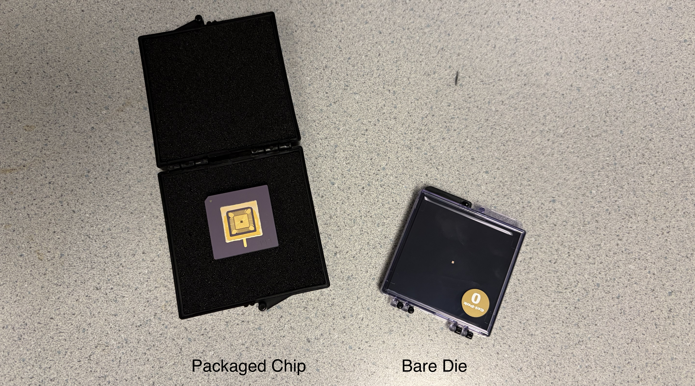
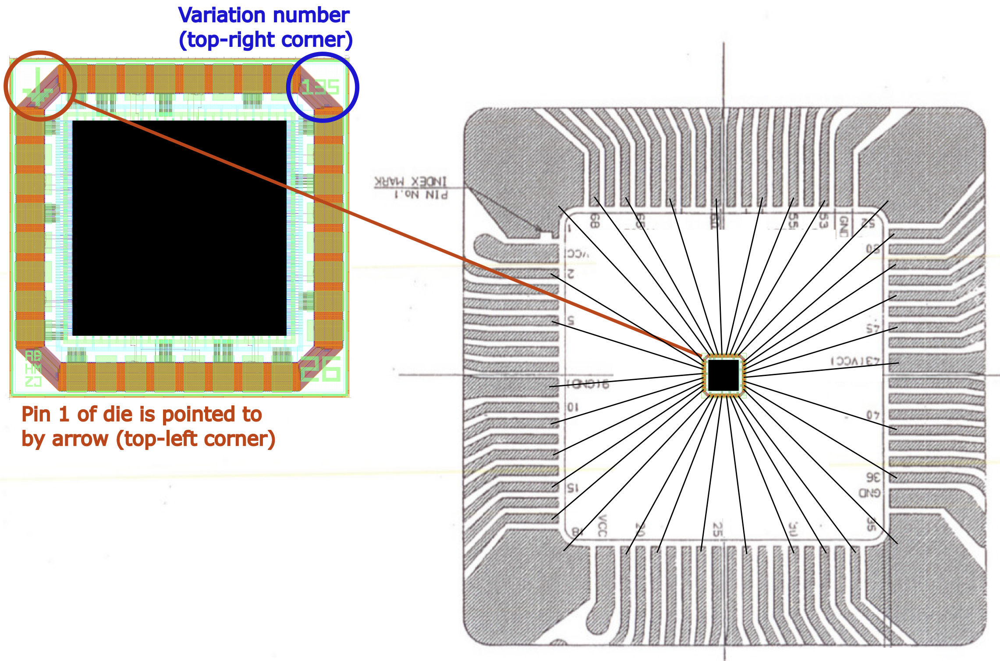
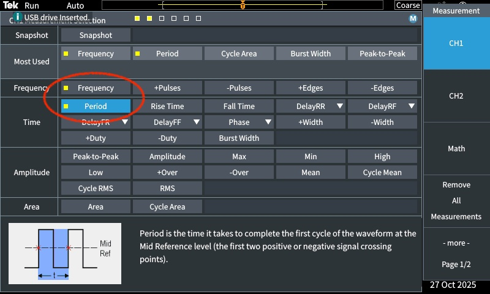
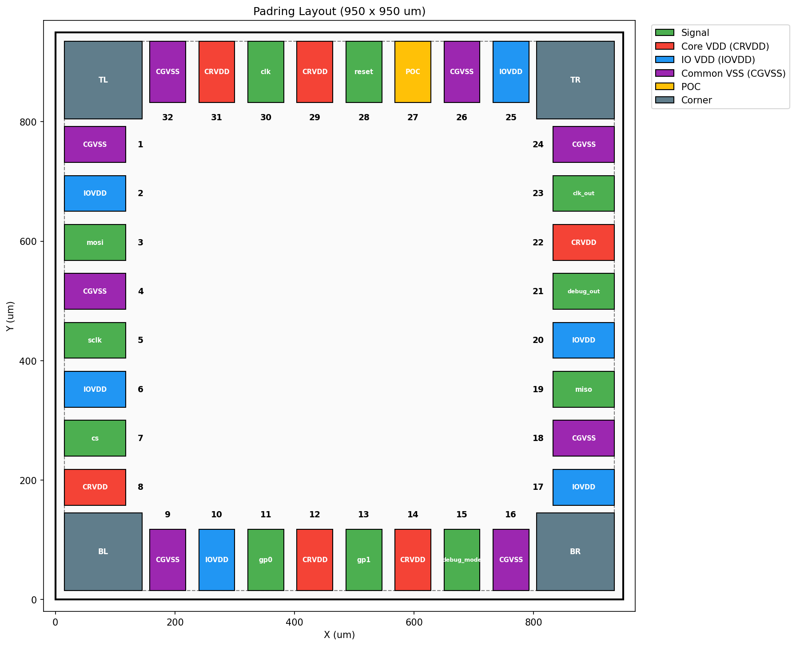
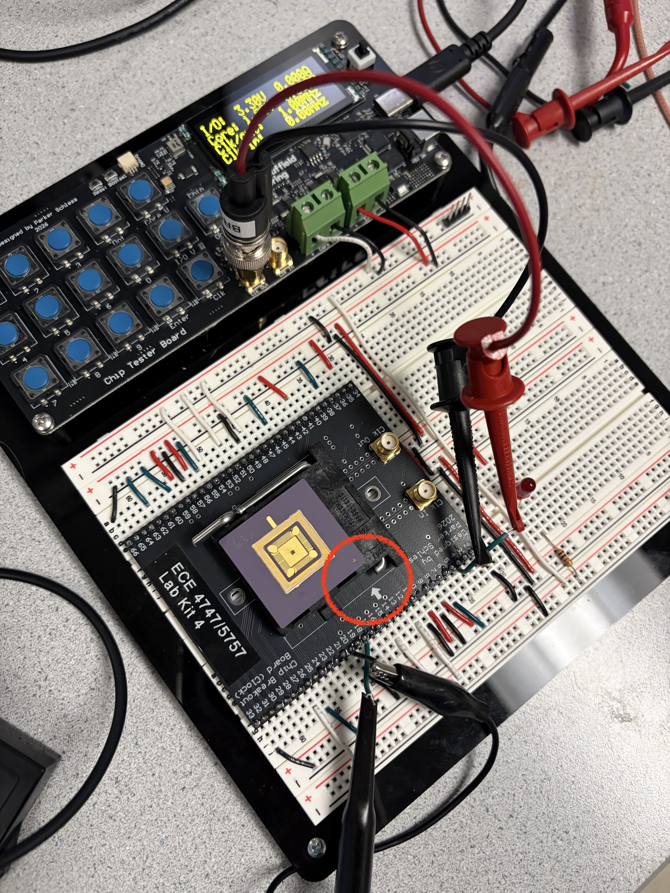
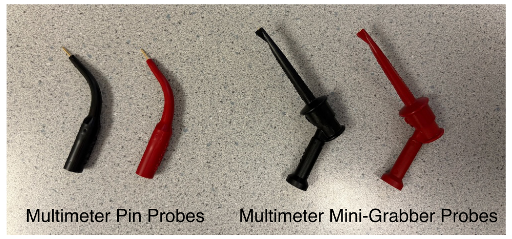
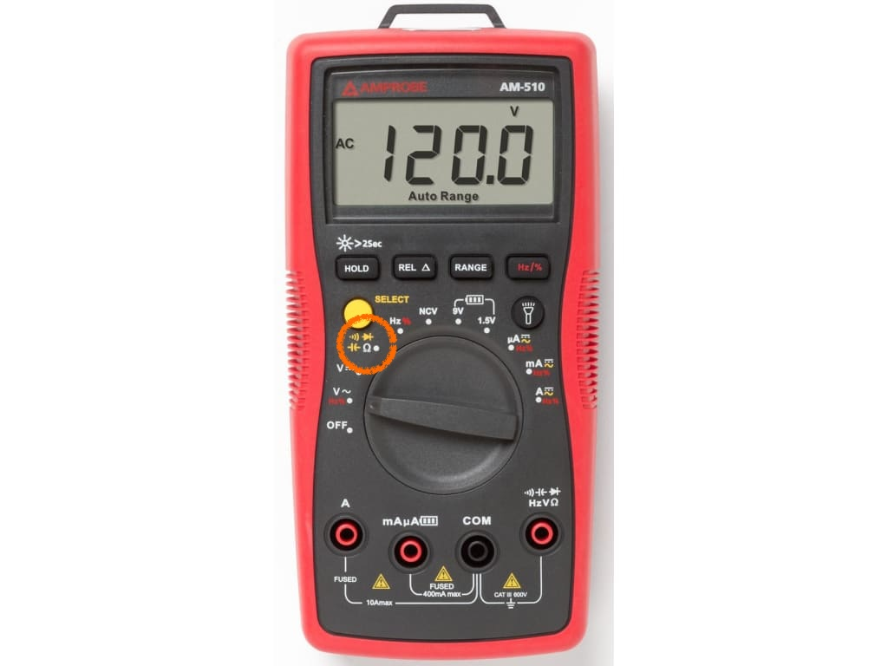
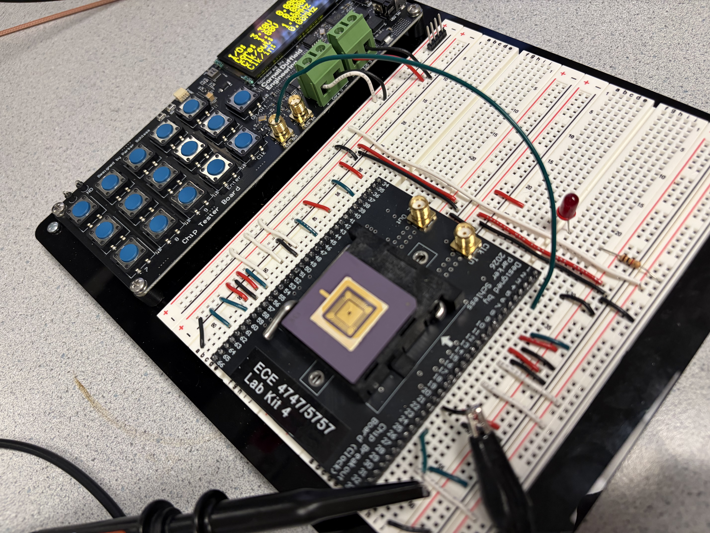

Lab 3: Clock Testing
==========================================================================

In this lab, you will inspect your chip under a microscope before
inserting it into the breakout board and testing the clock loopback path
through your chip. This is your first chance to see your chip and to
verify that the most basic capability is working!

1. Microscope
--------------------------------------------------------------------------

We are now going to look at your chip under the microscope! For this lab,
we will be using a relatively simple microscope. At the end of the
semester, students will have a chacne to use a much more sophisticated
microscope to be able to take a high quality photo of their chip. You
should have two versions of your chip:

 - **Bare Die:** This is the version of the chip that was sent from TSMC
   to MUSE, and which MUSE then sent to QP Technologies. The bare die is
   stored in a special box called a "GelPak". The bare die is just for
   us to look at. We will not be actually testing the bare die.

 - **Packaged Chip:** This is the version of the chip that was sent from
   QP Technologies to Cornell after the chip was wire bonded in a ceramic
   pin grid array (CPGA) package. The packaged chip is stored in a
   special box which protects it from electrostatic discharge (ESD). The
   packaged chip is what we will be actually testing.

!!! warning "Be careful with your bare die and pacakged chip!"

    Keep the bare die and packaged chips in their boxes and keep the
    boxes closed. Only open the boxes to look at the bare die and
    packaged chip under the microscope and when inserting the packaged
    chip into the breakout board. **NEVER TOUCH THE BARE DIE. NEVER TOUCH
    THE PINS ON THE PACKAGED CHIP!** We do not want to accidently cause
    an electrostatic discharge which might damage your chip.

### 1.1. Bare Die

Let's start by looking at the bare die under the microscope. The
microscope has a 10x eyepiece and a 2x/4x magnification resulting in an
overall zoom of 20x or 40x. You can adjust the zoom by rotating the blue
objective. Start with the magnification set to 2x (i.e., 20x zoom).

Turn on the microscope light using the power button on the back of the
microscope. You can adjust the light intensity using the dial on the side
of the microscope. Turn the light as bright as possible.

Now carefully open the GelPak and place the opened box under the
microscope. Look through the eyepieces. You can adjust the eyepieces to
be closer together or further apart. Do not press your eyes to the
eyepieces instead keep your eyes a 1-2 cm away from the eyepieces. You
want to see two circles merge into one so you can get a good stereo view
of your chip.

Adjust the focus until the bare die is sharp. Then go ahead and rotate
the blue object to 4x so you can better see the bare die. Look for the
following features in each of the four corners:

 - An arrow is pointing to pin 1
 - The number 26 indicates the chip is from Spring 2026
 - A three-digit project number
 - Student initials

Then look at the bare pads arranged around the outside of the chip. You
should be about to count 32 bare pads. Finally look at the power routing
on the top metal layer (i.e., metal 6).

Once you have finished looking at the bare die go ahead and remove it
from the microscope and close the GelPak.

### 1.2. Packaged Chip

Now let's look at the packaged chip under the microscope. Adjust the zoom
back a magnification of 2x (i.e., 20x zoom).

Now carefully open the ESD box and place the opened box. **DO NOT REMOVE
THE PACKAGED CHIP! LEAVE IT IN THE OPENED ESD BOX!** Look through the
eyepieces. Adjust the focus until the packaged chip is sharp. Then go
ahead and rotate the blue object to 4x so you can better see the packaged
chip. We are used _glass lids_ to cover the packaged chip so you can see
your chip inside the package. Again look for the following features in
each of the four corners:

 - An arrow is pointing to pin 1
 - The number 26 indicates the chip is from Spring 2026
 - A three-digit project number
 - Student initials

Notice how the wire bonds connect the wire bond pins around the outside
edge of the package to the bond pads on the actual die. You should be
able to visually confirm that the packaged chip is bonded according to
the bond diagram we sent to QP Technologies.

Once you have finished looking at the packaged chip go ahead and remove
it from the microscope and close the ESD box. Turn off the microscope
light and set it aside.

2. Clock Generator
--------------------------------------------------------------------------

Let's go ahead and test the clock generator on the chip tester board. Use
an SMA-to-BNC cable to connect the clock out SMA connecter on the chip
tester board to channel 1 of the oscilloscope. Turn on the oscilloscope
and press _Default Setup_. Then press _1_ to bring up the Channel 1
settings menu. Press the button next to _Attenuation_ and rotate the
multipurpose knob to set the attenuation to 1x. Then press the
multi-purpose knob to lock in this setting. Click the _Menu/Back_ button
to get the menu to go away.

You can now go ahead and use the UCB-C cable to power the chip tester
board. Change the clock frequency using the following steps:

 - Press the _Clk_ button
 - Use the numbers and _Dot_ button to enter 1
 - Press the _Enter_ button

Confirm the chip tester board displays 1MHz. Now press the _Chip_ button.
You should see the clock on the oscilloscope. Press _Autoset_ to have the
oscilloscope automatically determine the best way to display the clock
signal.

Now let's use the scope's measure feature to automatically measure the
frequency and period of the note square wave. Press the _Measure_ button.
Use the _Multipurpose_ knob to highlight _Frequency_. Then press the
_Multipurpose_ and a little yellow square should appear next to
_Frequency_ indicating it is selected.

Verify that the oscilloscope is showing a 1MHz clock signal. Now change
the clock frequency to 10MHz, 20Mhz, 30Mhz, 40Mhz, 50Mhz, 100Mhz, 150Mhz,
and 200Mhz. What do you see on the oscilloscope?

The chip tester board includes a frequency counter which can measure the
frequency of a clock connected to the clock in SMA connector. Turn off
the chip tester board and disconnect the SMA-to-BNC cable. Use the 6"
SMA-to-SMA cable to connect clock out to clock in on the chip tester
board. Turn the chip tester board back on. Change the clock frequency to
1MHz. Then press the _Chip_ button and verify that both clk/out and
clk/in shows 1Mhz. Now change the clock frequency to 10MHz, 20Mhz, 30Mhz,
40Mhz, 50Mhz, 100Mhz, 150Mhz, and 200Mhz. Confirm the frequency counter
indicates that the clock generator is correctly generating the entire
range of frequencies.

!!! warning "Disconnect the USB-C cable!"

    Now that we have finished testing the clock generator, remove the
    USB-C cable so we can be sure we do not accidently power the chip in
    the next section.

3. Signal I/O Routing
--------------------------------------------------------------------------

In the previous lab, you completed the power routing including I/O VDD,
core VDD, and ground. In order to do clock testing, we also need to
connect all of the signal input pins to ground. We cannot leave them
floating since that could cause issues with your chip. We will also be
doing our final continuity testing and resistance measurements with the
chip inserted into the breakout board.

### 3.1. Wire

Recall that the Project 2 tape-outs used the following pin out.

The pin numbers are shown on the pin out. Our chip has the following
pins:

 - 6 I/O VDD (already routed!)
 - 6 core VDD (already routed!)
 - 8 ground (already routed!)
 - poc (already routed!)
 - clk, clk_out
 - reset
 - cs, sclk, mosi, miso
 - debug_mode, debug_out
 - gp0, gp1

You need to connect the followign signal input pins to ground for today's
lab:

 - reset
 - cs, sclk, mosi
 - debug_mode
 - gp0, gp1

Use green jumper wires to connect each of these input pins to ground. You
do not need to make these jumper wires very flat. Make them bow a little
bit to make them easier to remove for the next lab.

The following spreadsheet maps the chip pin out to the pin numbers on the
breadboard:

 - <https://docs.google.com/spreadsheets/d/1JGBZUVgK5AarjHfcBgxE4LslBjMIDSYFS-cuk6Rjvk4>

!!! warning "You must double and triple check all routing!"

    You must be very careful in how you do your signal I/O routing. If
    you accidently connect I/O VDD or core VDD to an output pin you can
    damage your chip. So please carefully double and triple check your
    signal I/O routing.

### 3.2. Insert Chip

The time has come to finally insert your chip into your breadboard chip
tester! Before handling your packaged chip touch the metal part of the
lab bench to ensure there will be no electrostatic discharge. Lift the
arm next to the ZIF socket on the breakout board. Open the ESD box and
very carefully remove the packaged chip. **DO NOT TOUCH THE PINS!** Then
insert the chip into the ZIF socket. Do not force it. It should slip
easily into the ZIF socket. Pin 1 on the package is indedicated with the
small triangle. You must rotate the package so that pin 1 on the package
lines up with the arrow on the breakbout board. Then gently lower the arm
next to the ZIF socket which will lock your packaged chip into place. We
will leave the packaged chip inserted into the breakout board for the
remainder of the semester.

!!! warning "You must make sure your chip is inserted correctly!"

    If your chip is rotated incorrectly then you might damage your chip
    when you turn on the power. Double check that pin 1 on the package
    lines up with the arrow on the breakout board.

### 3.3. Continuity Test

Let's do one last continuity test. As in the last lab, we will be using
banana cables with the multimeter pin probes.

Turn on your handheld multimeter and set it to measure continuity as
shown below.

{ width="85%" }

You will need to press the yellow select button until you see the symbol
for continuity testing (i.e., the curved lines indicating sound waves) on
the display. Insert the black probe into the COM port on the multimeter
and the red probe into the right most port on the multimeter (with the
continuity symbol).

Insert the red multimeter pin probe into one of the I/O VDD rails. Then
insert the black probe into every pin next to the breakout board which is
wired. Ensure the multimeter only beeps when inserted into a pin which is
supposed to be connected to I/O VDD.

Insert the red multimeter pin probe into one of the core VDD rails. Then
insert the black probe into every pin next to the breakout board which is
wired. Ensure the multimeter only beeps when inserted into a pin which is
supposed to be connected to core VDD.

Insert the red multimeter pin probe into one of the ground rails. Then
insert the black probe into every pin next to the breakout board which is
wired. Ensure the multimeter only beeps when inserted into a pin which is
supposed to be connected to ground (this should include all of the signal
input pins including reset, cs, sclk, MOSI, debug_mode, gp0, gp1).

Double check that there is no beep when you probe ground and core VDD.
Double check that there is no beep when you probe ground and I/O VDD.

### 3.4. Measure Resitance

Since chip designers are paranoid, let's measure the resistance from VDD
to ground through the chip. If there is some kind of short we would see a
low resistance. Press the yellow select button until you see the Ohm
symbol for resistance measurement.

Insert the red multimeter pin probe near one of the I/O VDD pins of
the breakout board and the black multimeter pin probe near one of the
ground pins of the breakout board. Verify the resistance is in megaohms.

Insert the red multimeter pin probe near one of the core VDD pins of the
breakout board and the black multimeter pin probe near one of the ground
pins of the breakout board. Verify the resistance is in megaohms.

4. Clock Loopback
--------------------------------------------------------------------------

We are finally ready to do our very first test on our chip. We will send
a clock into the chip and look at the clock output on the oscilloscope.

!!! warning "Sketchy work around for today's lab!"

    As posted on Ed, there is an issue with the breakout boards. So for
    today we are going to do something very sketch as a work around. Be
    very careful and gentle with the work around! Next lab we should have
    a better solution ready for students to use, and we can experiment
    with higher frequency clock testing. We also do have one set of
    cables that students can share to do higher frequency clock testing.

Cut a roughly 6" length of jumper wire and strip about 0.3" off each end.
Then carefully insert the jumper into the middle of the clock out SMA
connector. **Be gentle!** Connect the other end of the jumper wire to the
clock input pin of the breakout board (i.e., pin 4). Connect the
oscilloscope up the clock output pin of the breakout board (i.e., pin
23). Connect the oscilloscopes ground alligator clip to a ground pin on
the breakout board as close as possible to the clock output pin. Here is
roughly what it should look like:

**Now double check everything!**

Once you are ready reconnect the USB-C cable to power the chip tester
board. Turn on the chip tester board and set the clock output to 1MHz.
**THIS IS VERY IMPORTANT! YOU MUST SET THE CLOCK OUTPUT TO 1MHZ ONLY!**
Go ahead and press the _Chip_ button.

If everything is working you should see a 1MHz clock on the scope. This
means the most basic functionality of your chip is working! The I/O VDD,
core VDD, and ground are all getting into your chip correctly, and the
clock signal is also able to get into your chip correctly.
Congratulations - we are making great progress!

