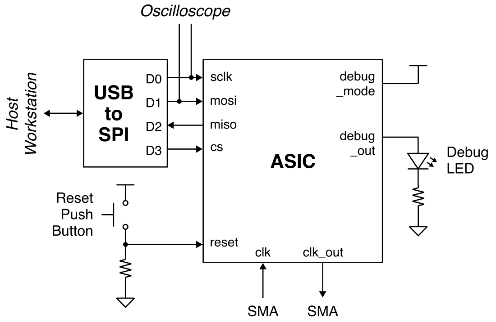
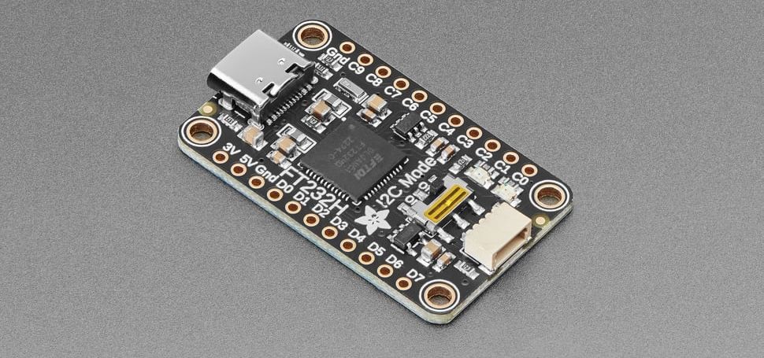
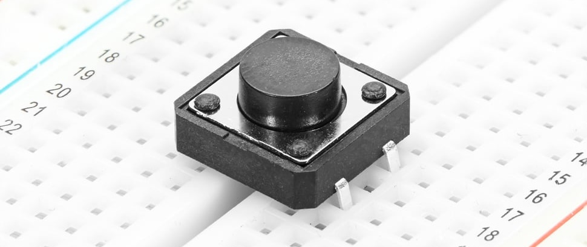
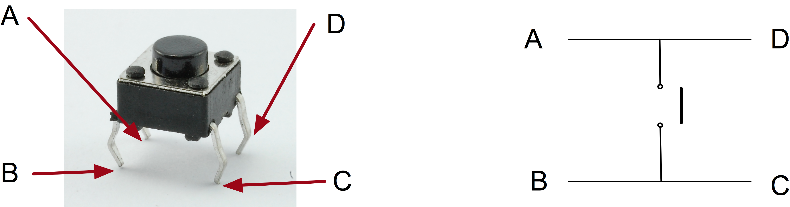

Lab 4: SPI Testing
==========================================================================

In this lab, you will wire up the USB-to-SPI adapter, reset button, and
debug output so you can test the SPI interface. Once we know the SPI
interface works we can try testing the actual accelerator in the next
lab!

1. Signal I/O Routing
--------------------------------------------------------------------------

In the previous lab, we connected the following signal input pins to
ground:

 - reset
 - cs, sclk, mosi
 - debug_mode
 - gp0, gp1

We left the following signal output pins unconnected:

 - miso
 - debug_out

We now need to connect CS, SCLK, MOSI, and MISO to the USB-to-SPI
adapter, connect the reset pin to a push button, connect the debug mode
input to 3.3V, and connect the debug out to an LED. You should leave
debug gp0 and gp1 connected to ground.

As a reminder, here is the spreadsheet which maps the chip pin out to the
pin numbers on the breadboard:

 - <https://docs.google.com/spreadsheets/d/1JGBZUVgK5AarjHfcBgxE4LslBjMIDSYFS-cuk6Rjvk4>

Here is a system-level diagram of the signal I/O routing for this lab:



### 1.1. Wire SPI

We will be using a USB-to-SPI adapter which enables us to communicate
with your chip from the workstation. This is the same adapter we used in
Lab 1 on FPGA emulation.

Remove the USB-to-SPI adapter from your component box and find a good
spot for it on your breadboard. You will want to place it at the edge on
the right-side of your breadboard so you can easily insert the USB-C
cable.



Then connect the ground pin of the USB-to-SPI adapter to the ground rail
on your breadboard. **Do NOT connect the 3V pin on the USB-to-SPI
adapter; only connect the ground pin!** You need to connect the SPI pins
to the USB-to-SPI adapter as follows:

 - SCLK connects to D0 on USB-to-SPI adapter
 - MOSI connects to D1 on USB-to-SPI adapter
 - MISO connects to D2 on USB-to-SPI adapter
 - CS connects to D3 on USB-to-SPI adapter

Cut long wires to make these connections. Try to make your wires flat
against the breadboard so they are nice and tidy.

### 1.2. Wire Reset

Our chip uses an active-high reset so we will need a push-button with a
pull-down resistor to control the reset input for our chip. When the
push-button is not pressed the resistor will pull down the reset pin to
0V. When you press the push-button, we will pull up the reset pin to
3.3V.

Remove the push-button from your component box and find a good spot for
it on your breadboard.



The following figure shows how the pins of the push button are connected
within the switch. You should either use A and C or B and D.



Connect one pin on the push button to the I/O VDD rail and the other pin
to a 1kOhm resistor which in turn connects to ground. Then connect the
node between the push button and the resistor to the reset pin of the
chip.

### 1.3. Wire Debug

Our chip uses an active-high debug mode input. In this lab, our chip will
always be in debug mode so connect the debug mode input pin to the I/O
VDD rail. Then connect the debug output to an LED in series with a 1kOhm
resistor which in turn connects to ground.

2. SPI Testing
--------------------------------------------------------------------------

We are now ready to test the SPI interface on your chip using debug mode.
Use a USB-C cable to connect the SPI adapter on the breadboard to the
top-left USB port of the workstation. **You must use the top-left USB
port of the workstation; any other port will not work!** Then use the
other USB-C cable to connect the chip tester board to the workstation.

Let's setup the oscilloscope so we can look at the SPI transactions.
Connect the two oscilloscope primary probe points to the SCLK and MOSI
pins of the SPI interface. Be sure also to connect the ground probe
points to ground.

 - Turn on the oscilloscope
 - Press _Default Setup_
 - Press _2_ to turn on Channel 2

### 2.1. Clone Repo

We now need to get the `ece6745-check-xmsgs` script from `ecelinux` onto
the workstation. This requires multiple steps.

 - Step 1. Click _Microsoft Edge_ on the desktop to open a web-browser on
   the workstation to log into GitHub and then find your repository

 - Step 2. Start PowerShell by clicking the _Start_ menu then searching
   for _Windows PowerShell_

 - Step 3. Use the following command to change to your home directory on
   the workstation in the lab (where `netid` is your Cornell NetID)

```
% cd C:\Users\netid
```

 - Step 4. Clone your repo onto the workstation by using this command in
   PowerShell (where `netid` is your Cornell NetID, **notice we are using
   https!**):

```
% git clone https://github.com/cornell-ece6745/project2-groupXX
```

 - Step 5. In the _Connect to GitHub_ pop-up, click _Sign in with your
   browser_

 - Step 6. You may be asked for your GitHub username again and you may be
   asked to authorize the Git Credential Manager; click _authorize
   git-ecosystem_

 - Step 7. Change into your repo, checkout the tapeout branch, and using
   `tree` on the workstation:

```
% cd project2-groupXX
% git checkout tapeout-v2-branch
% tree
```

### 2.2. Using REPL

Change the clock frequency to 1MHz using the following steps:

 - Press the _Clk_ button
 - Use the numbers and _Dot_ button to enter 1
 - Press the _Enter_ button
 - Press the _Chip_ button
 - Verify that the chip tester board clk/out and clk/in show 1MHz

Now start PowerShell by clicking the _Start_ menu then searching for
_Windows PowerShell_. Then start Python and use the following commands to
exchange SPI transactions with your chip. You should see the oscilloscope
flicker.

```bash
% python
>>> from pyftdi.spi import *
>>> spi_controller = SpiController()
>>> spi_controller.configure('ftdi://ftdi:232h/1')
>>> spi = spi_controller.get_port(cs=0, freq=1000, mode=0)
>>> spi.exchange(0xe0_0000_0001.to_bytes(5),5,duplex=True).hex()
>>> spi.exchange(0x80_0000_0000.to_bytes(5),5,duplex=True).hex()
>>> spi.exchange(0xe0_0000_0000.to_bytes(5),5,duplex=True).hex()
>>> spi.exchange(0x80_0000_0000.to_bytes(5),5,duplex=True).hex()
```

Why are we using 0xe0_0000_0001? Recall that the top three bits in an SPI
request correspond to the valid bit, the constant 1 bit, and the type
field. So the first transaction writes accelerator register xr0 with the
value 1.

Why are we using 0x80_0000_0000? Again that the top three bits in an SPI
request correspond to the valid bit, the constant 1 bit, and the type
field. So the second transaction is an invalid request; we are basically
waiting for the response message.

So the above sequence writes xr0 with the value 1, then writes xr0 with
the value 0. This should toggle the debug out pin (i.e., the LED).

Using the following steps to capture a waveform of the SPI packets on the
oscilloscope.

 - Rotate the _Horizontal Scale_ knob counter clockwise to 20ms
 - Continue to exchange SPI transactions (i.e., press up arrow key in
     PowerShell and then enter), see SPI packets flicker
 - Rotate the _Vertical Position_ knob of channel 2 counter-clock wise
 - Continue to exchange SPI transactions ... position channel 2 below
    channel 1 using _Vertical Position_ knob
 - Rotate the _Horizontal Position_ counter clockwise to move the signal
    to the left
 - Continue exchange SPI transactions and adjust the vertical/horizontal
     position
 - Rotate the _Trigger Level_ knob clockwise until the trigger is about
     1V higher than baseline voltage level
 - Press _Single_
 - Exchange an SPI transactions again to get a captured waveform

Now make sure reset is working as follows:

```bash
>>> spi.exchange(0xe0_0000_0001.to_bytes(5),5,duplex=True).hex()
```

Then press the rest button which should turn off the debug LED.

### 2.3. Using Python Script

We have provided you with a Python program to make it easier to send
accelerator requests to the FPGA emulator and eventually your chip. In
PowerShell on the workstation, change into the `xmsgs` subdirectory and
then run the `ece6745-check-xmsgs` script.

```bash
% cd C:\Users\netid\project2-groupXX\xmsgs
% python ece6745-check-xmsgs --help
```

You can use the `--debug-mode` command line option to write/read data
to/from the debug unit like this:

```bash
% cd C:\Users\netid\project2-groupXX\xmsgs
% python ece6745-check-xmsgs --verbose --debug-mode 1
```

The script will likely not work because the default SPI SCLK frequency
using this script is 1MHz. We cannot use a 1MHz chip clock to sample a
1MHz SCLK; the chip clock frequency needs to be ~6x the SCLK frequency.
Go ahead and change the chip clock frequency to 10MHz and rerun the
Python script.

```bash
% cd C:\Users\netid\project2-groupXX\xmsgs
% python ece6745-check-xmsgs --verbose --debug-mode 1
% python ece6745-check-xmsgs --verbose --debug-mode 0
% python ece6745-check-xmsgs --verbose --debug-mode 1
% python ece6745-check-xmsgs --verbose --debug-mode 0
% python ece6745-check-xmsgs --verbose --debug-mode 0xdeadbeef
```

Verify that the debug output LED is toggling. If this looks like it is
working, then use 0xdeafbeef and change the clock frequency to 20Mhz,
30Mhz, 40Mhz, 50Mhz, 100Mhz, 150Mhz, and 200Mhz. Confirm the frequency
counter shows the correct frequency and that the SPI responses are
correct.

!!! success "Huge Milestone!"

    If the SPI testing works then this means I/O VDD, core VDD, ground,
    clock, and your reset signal are all working and you can now get data
    in and out of the chip! Congratulations - we are making great
    progress!

