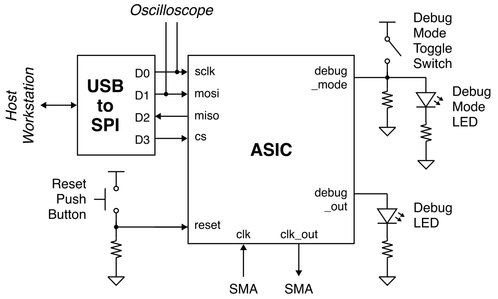
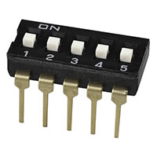

Lab 5: Accelerator Testing
==========================================================================

In the previous labs you wired up the power and signal I/Os, tested
getting a clock in and out of your chip, and tested your SPI interface.
In this lab you will wire up the debug mode input to a switch so you can
switch between debug mode and accelerator testing mode. Then you
use the xmsgs created in the first lab to test your accelerator at
nominal voltage and frequency before sweeping both voltage and frequency
to create a shmoo plot.

1. Signal I/O Routing
--------------------------------------------------------------------------

In the previous lab, we connected the following signal I/O pins:

 - reset connected to a push button
 - cs, sclk, mosi, miso connected to the USB-to-SPI adapter
 - debug_out connected to an LED
 - gp0, gp1 connected to ground
 - debug_mode connected to 3.3V

We now want to connect the debug_mode input to a toggle switch so we can
switch between debug mode and accelerator testing mode. We also want to
connect the debug_mode input to an LED so we can easily know if we are in
debug_mode or not.

As a reminder, here is the spreadsheet which maps the chip pin out to the
pin numbers on the breadboard:

 - <https://docs.google.com/spreadsheets/d/1JGBZUVgK5AarjHfcBgxE4LslBjMIDSYFS-cuk6Rjvk4>

Here is a system-level diagram of the signal I/O routing for this lab:



### 1.1. Wire Debug

Remove the 5-position DIP toggle switch from your component bin and find
a good spot for it on your breadboard.



Pick one of the positions to use as the debug mode toggle switch. The
debug mode input is active high so we will need a pull-down resistor to
control the debug mode input for our chip. When the toggle switch is
open, the resistor will pull down the debug mode pin to 0V. When the
toggle switch is closed, we will pull up the debug pin pin to 3.3V.

Then connect the debug mode input to an LED (use a different color from
what you used for the debug output!) in series with a 1kOhm resistor
which in turn connects to ground.

2. SPI Testing
--------------------------------------------------------------------------

We should test the SPI interface again just to make sure everything is
still working. Use a USB-C cable to connect the SPI adapter on the
breadboard to the top-left USB port of the workstation. **You must use
the top-left USB port of the workstation; any other port will not work!**
Then use the other USB-C cable to connect the chip tester board to the
workstation.

### 2.1. Clone Repo

We now need to get the `ece6745-check-xmsgs` script from `ecelinux` onto
the workstation. This requires multiple steps.

 - Step 1. Click _Microsoft Edge_ on the desktop to open a web-browser on
   the workstation to log into GitHub and then find your repository

 - Step 2. Start PowerShell by clicking the _Start_ menu then searching
   for _Windows PowerShell_

 - Step 3. Use the following command to change to your home directory on
   the workstation in the lab (where `netid` is your Cornell NetID)

```
% cd C:\Users\netid
```

 - Step 4. Clone your repo onto the workstation by using this command in
   PowerShell (where `netid` is your Cornell NetID, **notice we are using
   https!**):

```
% git clone https://github.com/cornell-ece6745/project2-groupXX
```

   If you already cloned the repo, then you may not need to do anything
   or you might need to do a pull if there are any changes.

 - Step 5. In the _Connect to GitHub_ pop-up, click _Sign in with your
   browser_

 - Step 6. You may be asked for your GitHub username again and you may be
   asked to authorize the Git Credential Manager; click _authorize
   git-ecosystem_

 - Step 7. Change into your repo, checkout the tapeout branch, and using
   `tree` on the workstation:

```
% cd project2-groupXX
% git checkout tapeout-v2-branch
% tree
```

### 2.3. Using Python Script

Make sure the debug mode toggle switch is set such that the debug mode
input is at 3.3V and the debug mode LED is on. Change the clock frequency
to 10MHz using the following steps:

 - Press the _Clk_ button
 - Use the numbers and _Dot_ button to enter 10
 - Press the _Enter_ button
 - Press the _Chip_ button
 - Verify that the chip tester board clk/out and clk/in show 10MHz

In PowerShell on the workstation, change into the `xmsgs` subdirectory
and then run the `ece6745-check-xmsgs` script with the `--debug-mode`
command line option to write/read data to/from the debug unit like this:

```bash
% cd C:\Users\netid\project2-groupXX\xmsgs
% python ece6745-check-xmsgs --verbose --debug-mode 1
% python ece6745-check-xmsgs --verbose --debug-mode 0
% python ece6745-check-xmsgs --verbose --debug-mode 1
% python ece6745-check-xmsgs --verbose --debug-mode 0
% python ece6745-check-xmsgs --verbose --debug-mode 0xdeadbeef
```

Verify the debug output LED is toggling. Now flip the debug mode toggle
switch so we are no longer in debug mode and confirm the debug mode LED
is off. Press the reset butto to reset your chip.

3. Accelerator Testing
--------------------------------------------------------------------------

Now that we know the SPI is working, we can test the actual accelerator
using the xmsgs files we generated in Lab 1. First we need to figure out
what the nominal frequency is for your chip. This depends on what clock
constraint was used when you met timing before taping out your chip. Keep
in mind that we had to respin some student's tapeouts after we fixed the
power grid issue last spring, and thus the final clock constraint might
be different from what you remember. This spreadsheet shows you the clock
period which was used for the final tapeout of each group:

 - <https://docs.google.com/spreadsheets/d/1H4j1VBuE1x00wQHnXtg_rD_B_fkUrHKs7rDqy92OY0c>

Recall that we used three "corners" when closing timing for your chip:

| Corner  | Temperature (C) | Temperature (F) | Voltage |
|---------|-----------------|-----------------|---------|
| Typical | 25              | 77              | 1.80    |
| Worst   | 125             | 257             | 1.62    |
| Best    | 0               | 32              | 1.98    |

In the lab, our conditions will probably be close to the typical-case
corner. The spreadsheet shows the slack at each corner. To close timing
we needed to meet the setup time constraint at the worst-case corner, but
this means there will be significant slack at the typical- and best-case
corners. The spreadsheet also shows the effective frequency at each
corner (i.e., 1/(clock_period - slack)).

Let's use the typical frequency and 1.8V as the nominal operating
conditions. Go ahead and change the clock frequency to the typical
frequency for your group, and make sure that the chip tester board
clk/out and clk/in show this frequency.

Now pick the simplest xmsg file you have. Let's assume it is called
`simple.xmsgs`. Then use the `ece6745-check-msgs` script to replay the
accelerator requests and check the accelerator responses.

```bash
% cd C:\Users\netid\project2-groupXX\xmsgs
% python ece6745-check-xmsgs --verbose simple.xmsgs
```

Try a few more and then try all of them at once.

```bash
% cd C:\Users\netid\project2-groupXX\xmsgs
% python ece6745-check-xmsgs *.xmsgs
```

!!! warning "Some groups might need to reset the chip between xmsgs"

    Some groups learned during lab 1, that their accelerator actually
    only works if it is reset before each xmsg. The reason they did not
    catch this issue during pre-silicon verification is because our test
    framework resets the chip before each test case. These groups will
    need to spend time modifying their chip testing setup as follows:

      1. Wire up the reset input to one of the GPIO pins on the
         USB-to-SPI adapther instead of to the push button
      2. Modify the `ece6745-check-xmsgs` script to toggle this GPIO pin
         high to reset the chip before each xmsgs test
      3. Look at the reset pin on the scope to make sure that everything
         is working

4. Shmoo Plot
--------------------------------------------------------------------------

Now that you know your chip works at nominal frequency and voltage we
want to make a shmoo plot to better evaluate the entire operating range
of your chip. A shmoo plot is a 2D grid with voltage on the X-axis and
clock frequency on the Y-axis. Each shmoo plot entry indicates whether or
not your chip passes all your tests at the given voltage and frequency.
Here is a template you can use for your shmoo plot:

 - <https://docs.google.com/spreadsheets/d/1479kw--S2C_pjLiD9tBvi46QyNUJGVQfuQ5uJzMIFQc>

Make a copy of this Google spreadsheet. Start in the bottom left corner
with the first column at the lowest voltage (1.4V) and and the slowest
clock frequency (1MHz). Run your tests then enter one of three values:

 - P = all tests pass
 - x = some tests pass and some tests fail
 - F = all tests fail

Then gradually increase the frequency from 1MHz to 200Mhz. At each
frequency rerun all your tests and update the corresponding shmoo plot
entry. Once you have finished the first column, then increae the voltage
to 1.5V and repeat the experiments.

Your chip will not pass the tests at 1MHz. Revisit Lab 4 to understand
why. Remember what we learned last spring about static timing analysis to
understand what region of the shmoo plot you might expect the chip to
pass and what region of the shmoo plot you might expect the chip to fail.

!!! success "Huge Milestone!"

    Your chip is now fully functional at nominal frequency and voltage,
    and you have also carefully evaluated its functionailty across a
    broad operating range. This is a huge accomplishment!

