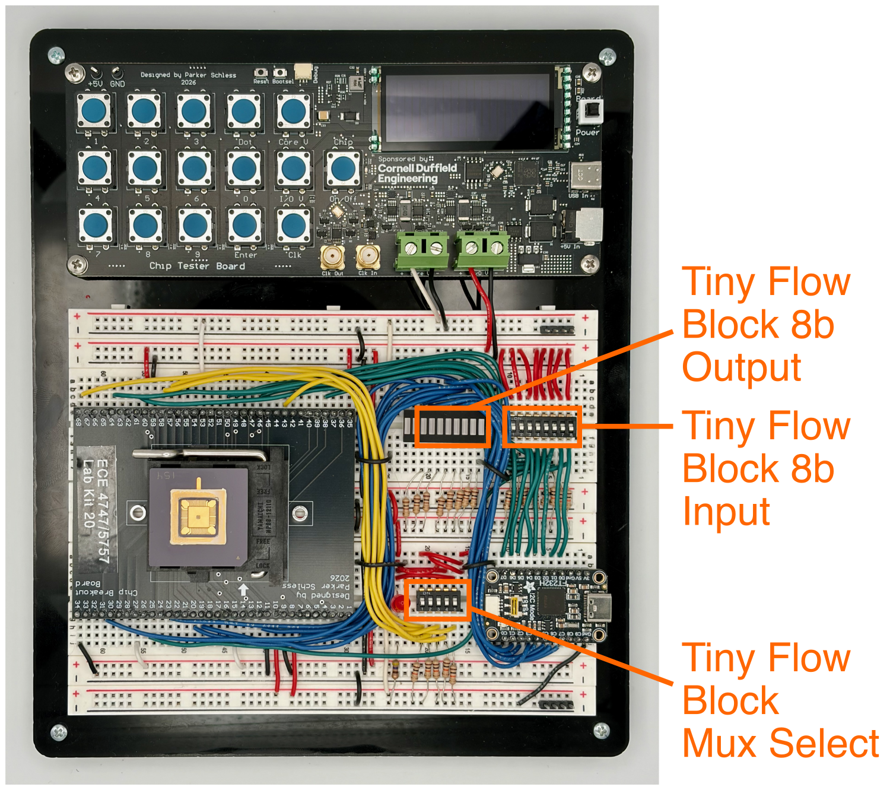
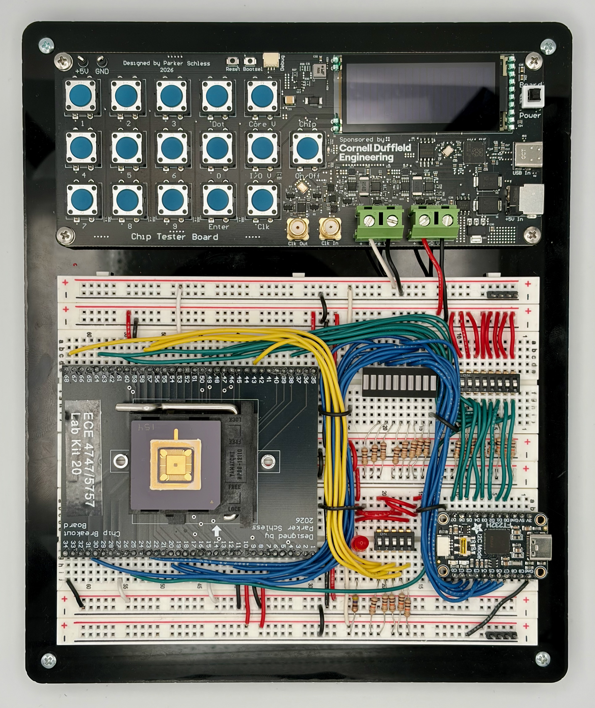
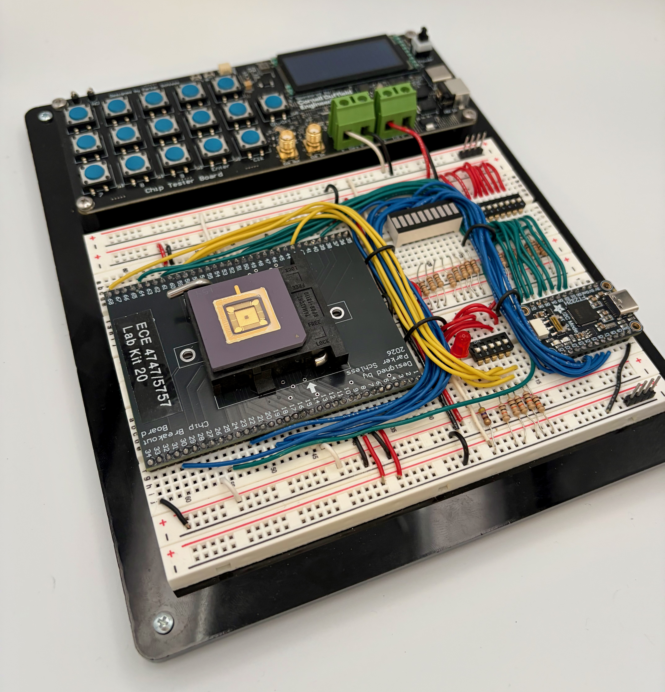
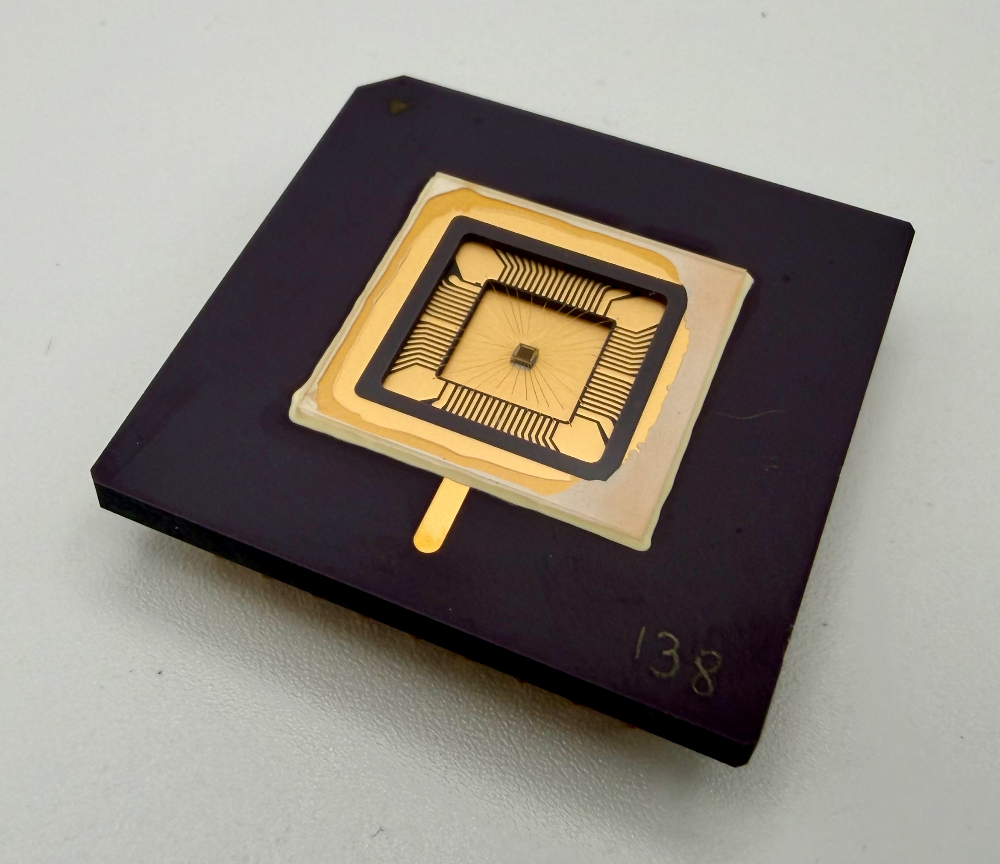
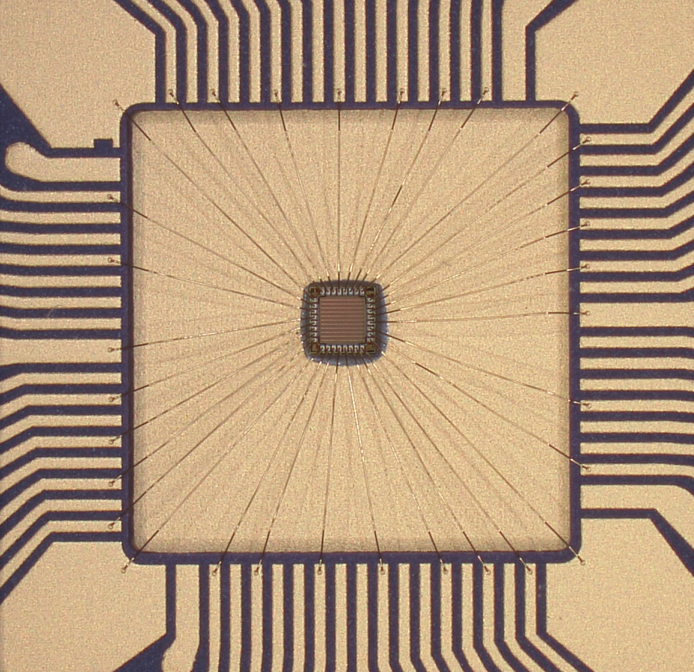
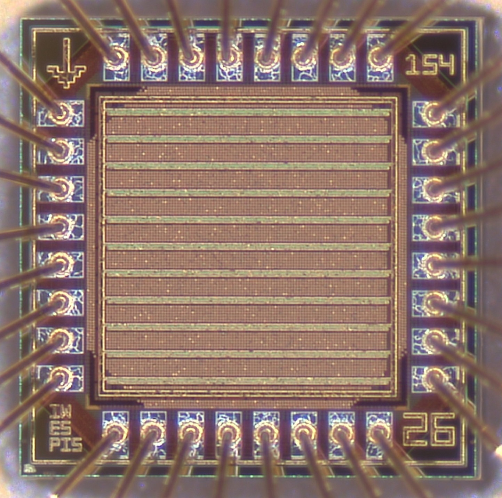
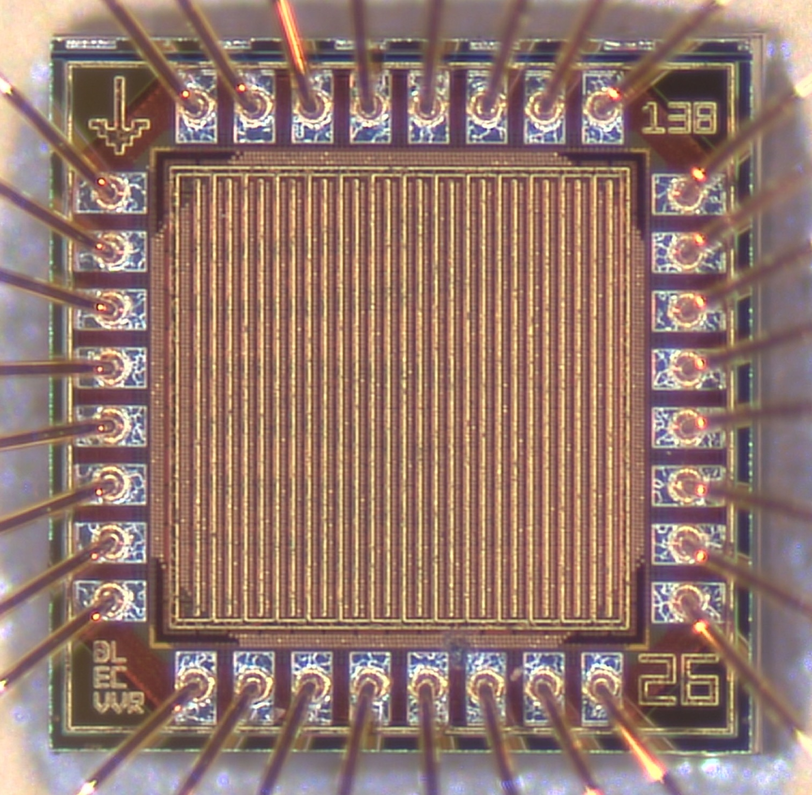
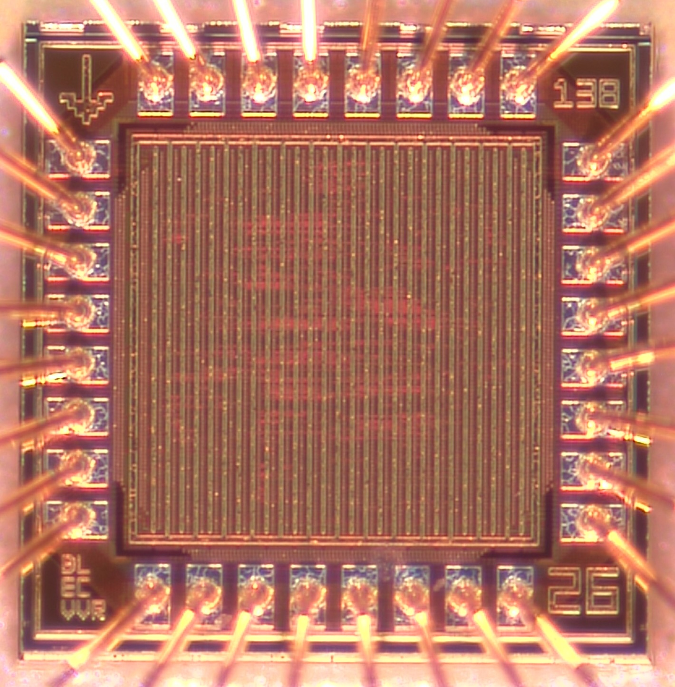
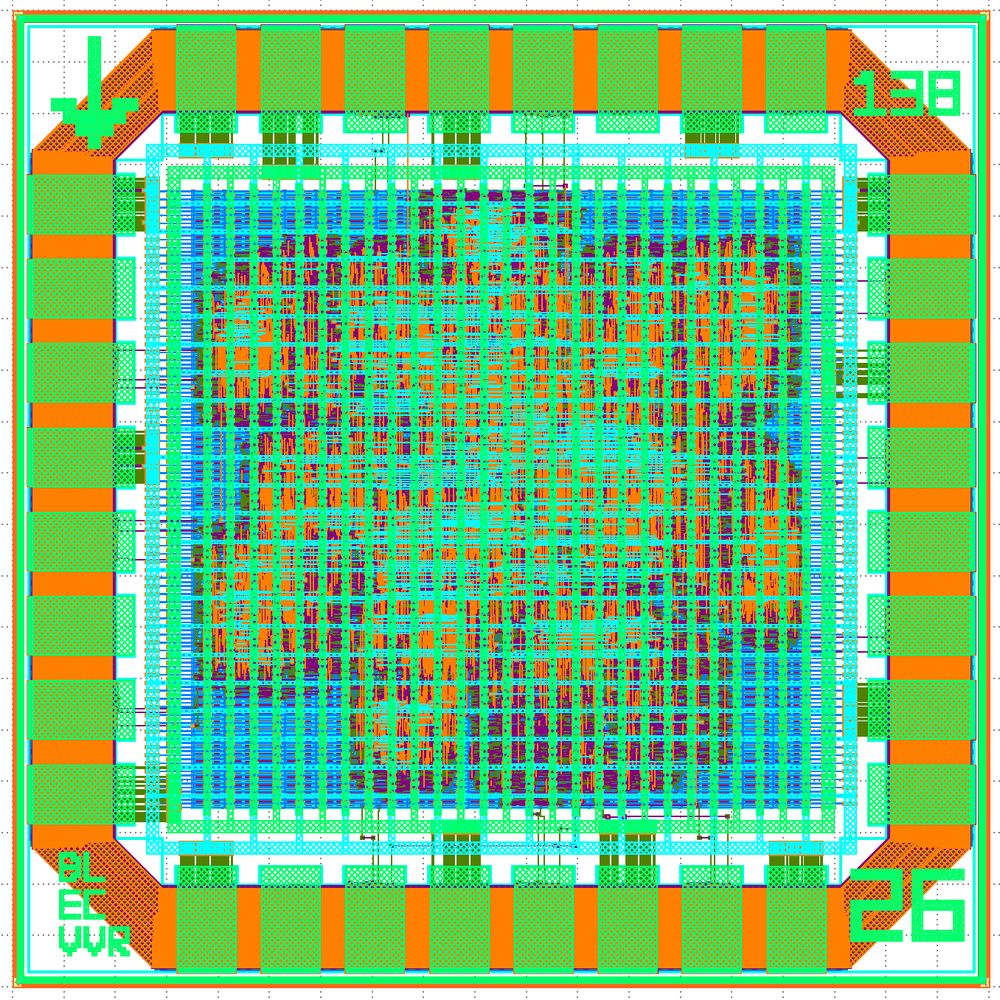
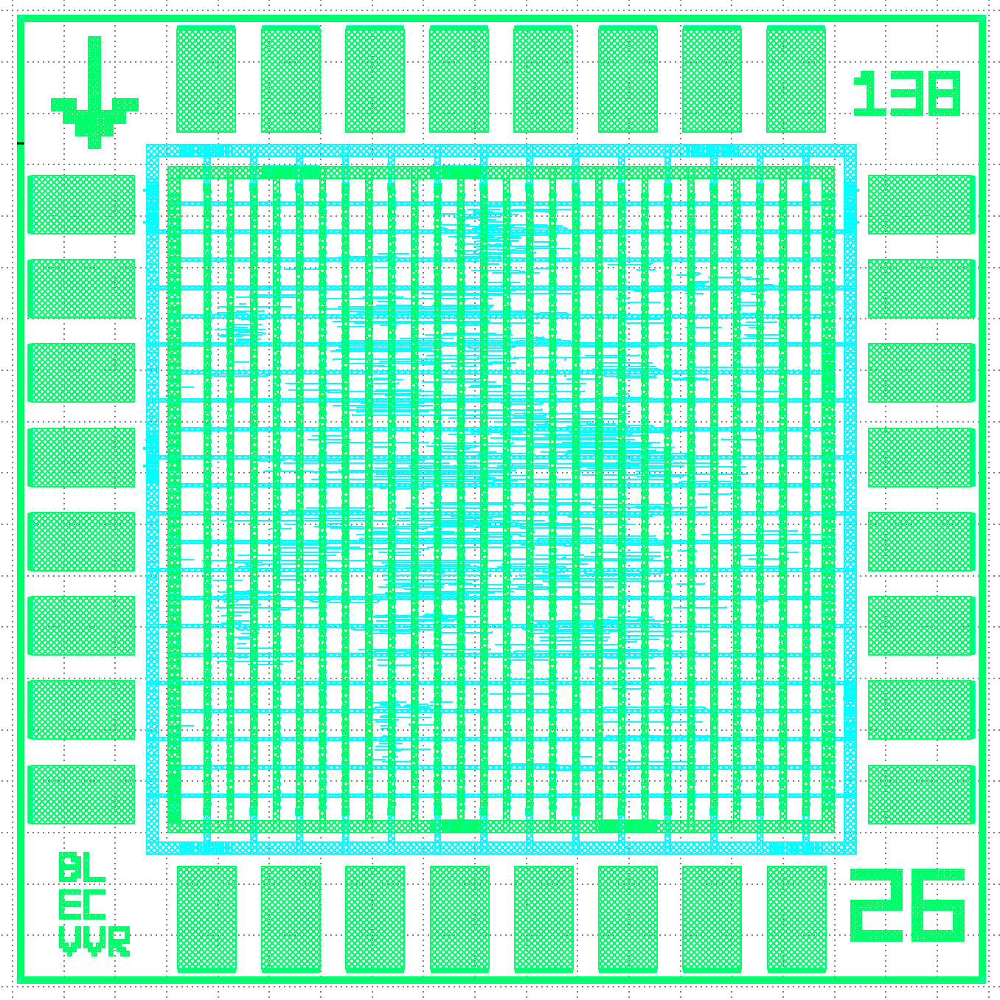

Lab 6: Tiny Flow Chip Testing
==========================================================================

You have now successfully tested your project 2 accelerator tape-out! In
this final lab, you will test your projec 1 tiny flow tape-out. You will
also take photos of your chip testing platform and your project 2 chip
for your final report, and at the very end of the lab you will able to
take your project 2 accelerator tape-out home with you.

1. Revisiting Tiny Flow Tape-Out
--------------------------------------------------------------------------

It has been almost 10 months since you completed your project 1 tiny flow
tape-out, so take a few minutes to remind yourself what you taped out by
going to your project 1 repo:

 - `https://github.com/cornell-ece6745/project1-groupXX`

Log onto ecelinux and rerun your tests (or the entire tiny flow!) like
this:

```
% source setup-ece6745.sh
% mkdir -p ${HOME}/ece6745
% cd ${HOME}/ece6745
% git clone git@github.com:cornell-ece6745/project1-groupXX
% cd project1-groupXX/asic
% mkdir build-tapeout
% cd build-tapeout
% pyhflow ../designs/tapeout-group01.yml
% ./01-verilator-rtlsim/run
% ./02-iverilog-rtlsim/run
```

Now you need to create a spreadsheet which includes all 256 inputs and
the expected outputs. We can use this spreadsheet for automatic
exhaustive testing of your project 1 tiny flow tape-out. Make a copy of
the following spreadsheet:

 - <https://docs.google.com/spreadsheets/d/1r03AOZy56Z21QhXVUwIAtccmoXYBNZv4mNuCu1BiCdw>

You need to fill in the _Outputs (Decimal)_ column, or you can also fill
in the _Outputs (Binary)_ column directly if you like. Either determine
the correct outputs manually, add additional output to your test bench,
and/or take a close look at your tapeout tests here:

 - `https://github.com/cornell-ece6745/project1-groupXX/rtl/test/TapeoutGroupXX-test.v`

2. Testing Tiny Flow Tape-Out
--------------------------------------------------------------------------

!!! warning "We only have a single tiny flow tape-out test board!"

    We only have a single tiny flow tape-out test board, so you might
    need to wait until it is free. Feel free to work on taking photos of
    your chip testing platform and/or your project 2 chip while you wait.

The tiny-flow test board is similar to the test board you have been
working on for your project 2 tape-out, but it is wired up very
differently.



There are 25 tiny-flow blocks on the chip with an 8-bit 25-to-1 mux at
the top-level of the chip. The 5-bit mux select is brought out to five
input pins which are then connected to a 5-position DIP switch. Use the
small screwdriver in your component box to carefully set the 5-position
DIP switch to your group number. The test board also includes DIP
switches for setting the eight inputs to your block and LEDs for reading
the eight outputs from your block.

There are two ways to use the tiny-flow test board. For manual testing,
we will be manually setting the inputs using the DIP switches and reading
the outputs using the LEDs. For automated testing, we will be using the
workstation and the USB-to-SPI adapter to set the inputs and and read the
outputs. For manual testing, do NOT connect the workstation to the
USB-to-SPI adapter. For automated testing, set all of the input DIP
switches to zero and then connect the USB-to-SPI adapter to the
workstation.

### 2.1. Manual Testing

Go ahead and power on the tiny-flow test board by using the USB-C cable
to plug the chip tester board into the workdation. Power on the tiny flow
chip using the _Chip_ button on the tester board and make sure the red
LED turns on. Now choose a row from your spreadsheet and set the 8-pos
DIP switch to the corresponding input value. Read the outputs using the
blue LEDs. Compare the actual outputs with the expected outputs in your
spreadsheet and mark this row as "passed" if they match.

### 2.2. Clone Repo

We now need to get a new `ece6745-proj1-chip-test` script from your repo
onto the workstation. This requires multiple steps.

 - Step 1. Click _Microsoft Edge_ on the desktop to open a web-browser on
   the workstation to log into GitHub and then find your repository

 - Step 2. Start PowerShell by clicking the _Start_ menu then searching
   for _Windows PowerShell_

 - Step 3. Use the following command to change to your home directory on
   the workstation in the lab (where `netid` is your Cornell NetID)

```bash
% cd C:\Users\netid
```

 - Step 4. Clone your repo onto the workstation by using this command in
   PowerShell (where `netid` is your Cornell NetID, **notice we are using
   https!**):

```
% git clone https://github.com/cornell-ece6745/project1-groupXX
```

   If you already cloned the repo, then you may not need to do anything
   or you might need to do a pull if there are any changes.

 - Step 5. In the _Connect to GitHub_ pop-up, click _Sign in with your
   browser_

 - Step 6. You may be asked for your GitHub username again and you may be
   asked to authorize the Git Credential Manager; click _authorize
   git-ecosystem_

 - Step 7. Change into your repo, checkout the tapeout branch, and using
   `tree` on the workstation:

```bash
% cd project1-groupXX
% tree
```

Make sure you have this new script:

 - `project1-groupXX/chip-test/ece6745-proj1-chip-test`

### 2.2. Automated Testing

Press the _Chip_ button to turn off power to the tiny flow chip. Set all
of the input DIP switches to zero. Use the USB-C cable to connect the SPI
adapter on the breadboard to the top-left USB port of the workstation.
**You must use the top-left USB port of the workstation; any other port
will not work!** Then press the _Chip_ button again to turn on power to
the tiny flow chip.

In PowerShell on the workstation, change into the `chip-test`
subdirectory and then run the `ece6745-proj1-chip-test` script with the
`--inputs` command line option to set the inputs like this:

```bash
% cd C:\Users\netid\project1-groupXX\chip-test
% python ece6745-proj1-chip-test --inputs 0b00000001
```

The script should set the inputs to the tiny flow chip and you should see
the corresponding outputs on the blue LEDs. Confirm the output is correct
using your spreadsheet and mark the output "passed". Try a few more
inputs.

Now let's automate the process. You need to download your Google
spreadsheet as a CSV file to the workstation using _File > Download >
Comma Separated Values_. Then move the CSV file into your `chip-test`
directory on the workstation and rename the CSV file `proj1.csv`.

```bash
% cd C:\Users\netid\project1-groupXX\chip-test
% python ece6745-proj1-chip-test --step proj1.csv
```

The script will try each input one at a time and wait for you to press
enter before moving on to the next input. The script will automatially
check to ensure the outputs from the tiny flow chip match the expected
values in the spreadsheet. Try a bunch of inputs, then press Control-C to
quit and run all inputs at once like this:

```bash
% cd C:\Users\netid\project1-groupXX\chip-test
% python ece6745-proj1-chip-test proj1.csv
```

If you see 256 passed checks then you have successfully exhaustively
tested your tiny flow block on the tiny flow chip!

!!! success "Huge Milestone!"

    Your tiny flow block is now fully functional. Unlike your accelerator
    chip, you designed every standard cell in your tiny flow block from
    scratch! You designed your own technology mapping tool using tree
    covering, static timing tool using tree traversals, placement tool
    using simulated annealing, and routing tool using 3D maze routing.
    This is a huge accomplishment!

3. Board and Chip Photos
--------------------------------------------------------------------------

Now that your chips have been fully tested it is time to take some photos
for your final report. Now is the time to clean up your breadboard wiring
to make it look nice and tidy! We have a light box and microscope and we
would like you to take photos of:

 - Chip tester board in the light box
 - Packaged chip in the light box
 - Packaged chip under the microscope zoomed out
 - Packaged chip under the microscope zoomed in

Here is an example of two photos of the tiny flow board in the light box:





Here is an example of the packaged chip in the light box:



Here is an example of the tiny flow chip zoomed out so you can see the
bond wires under the microscope:



And here is an example of the tiny flow chip zoomed in so you can really
see the bond pads, metal 6 power grid, and the chip art in the corners.



Here is an example of group 4's chip zoomed in.



You might want to experiment using gooseneck LED illumination to see if
you can higlight the metal 5 routing. Here is an example of the group 4
chip with the light hitting the chip just right to make the metal 5
routing refract light in a different color.



Here is the complete GDS for group 4 and the GDS with just metal 5 and 6.
You can see how the highlighted routing under the microscope corresponds
to the metal 5 routing.





Have fun taking some nice photos! You will need to include these in your
report but also feel free to include them on your webpage and/or post
them on social media!

4. Taking Your Chip Home
--------------------------------------------------------------------------

This is the final lab of the semester, so you are now free to take your
chip home as a keepsake! We will give you an ESD box to put it in, and
you need to sign this form and email it back to Prof. Batten.

 - <https://drive.google.com/file/d/1VSy9y7i3za4moM1GyEShj9BKiJITSRRr>

